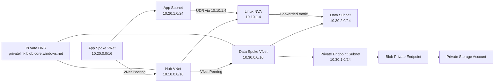

# Azure Enterprise Network

An Azure Cloud Engineering portfolio project focused on designing and operating an enterprise-style network using **Terraform-first Infrastructure as Code**.

This project is intentionally separate from the highly available web application project. The goal here is to go deeper into **Azure networking, private connectivity, DNS, routing, security, monitoring, and troubleshooting**.

## Project Status

**Current phase:** Complete  
**Overall progress:** 100%

## Business Scenario

A fictional organisation needs a secure Azure network that can host multiple workloads while keeping shared services centrally managed.

The environment will use a **hub-and-spoke architecture** so that shared networking services can live in the hub while application/data workloads are isolated in separate spokes.

## Target Skills

This project will demonstrate:

- Azure Virtual Networks and subnet design
- CIDR planning
- Hub-and-spoke architecture
- VNet peering
- Network Security Groups
- User Defined Routes
- Private Endpoints
- Azure Private DNS
- Network Watcher / connectivity troubleshooting
- Azure Monitor / Log Analytics
- Terraform-first Infrastructure as Code
- Remote Terraform state
- GitHub Actions CI
- Azure OIDC authentication
- Documentation and architecture diagrams

## Architecture



The final design uses hub-and-spoke networking with non-transitive VNet peering, a Linux NVA for spoke-to-spoke forwarding, UDRs on the application and data subnets, subnet-level NSGs, Private Endpoint connectivity, and Azure Private DNS.

## Terraform Structure

```text
terraform/
├── versions.tf
├── providers.tf
├── variables.tf
├── main.tf
└── outputs.tf
```

Terraform will be used **before** resources are created in Azure. This is different from Project 1, where existing resources were later imported into Terraform.

## Project Roadmap

- [x] Create GitHub repository
- [x] Create Terraform project structure
- [x] Design the IP address plan
- [x] Build the hub VNet
- [x] Build application and data spoke VNets
- [x] Configure VNet peering
- [x] Design and apply subnet-level NSGs
- [x] Add routing / UDRs
- [x] Add Private Endpoint connectivity
- [x] Configure Azure Private DNS
- [x] Add monitoring and network diagnostics
- [x] Configure remote Terraform state
- [x] Add GitHub Actions validation
- [x] Configure Azure OIDC authentication
- [x] Perform deliberate network failure tests
- [x] Complete final architecture and troubleshooting documentation

## Engineering Approach

For each major task, this repository will document:

```text
Requirement
    ↓
Design decision
    ↓
Terraform implementation
    ↓
Validation
    ↓
Troubleshooting
    ↓
Lesson learned
```

The objective is not only to build a working Azure network, but to demonstrate the reasoning and troubleshooting expected from a Cloud Engineer.


## Validation Highlights

- Terraform state is stored remotely in Azure Storage.
- GitHub Actions runs `terraform fmt -check`, `terraform init -backend=false`, and `terraform validate`.
- GitHub Actions authenticates to Azure using OIDC with no stored client secret.
- Network Watcher confirmed TCP 443 from the App VM to the Data VM is reachable through the Hub NVA.
- Network Watcher confirmed TCP 8080 is blocked by the explicit Data NSG deny rule.
- The routing failure and remediation are documented in `docs/troubleshooting.md`.

## Key Engineering Lessons

Azure VNet peering is non-transitive. App-to-Hub and Data-to-Hub peerings do not automatically create App-to-Data connectivity. The working design required UDRs plus a forwarding device in the hub. The troubleshooting process used Network Watcher to identify the missing route and NSG behaviour before implementing the NVA remediation.
